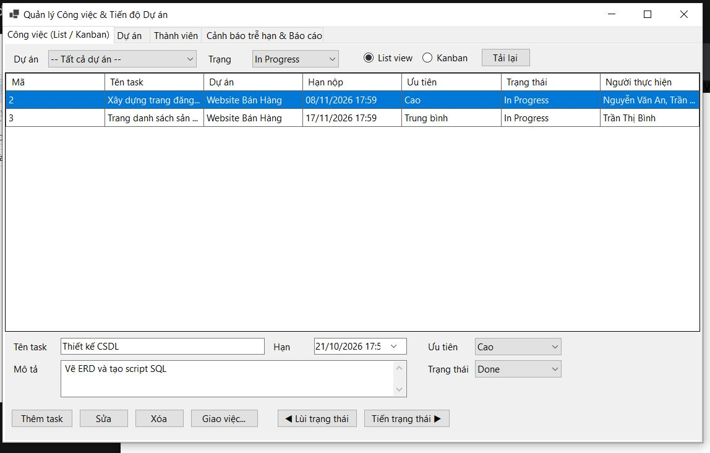
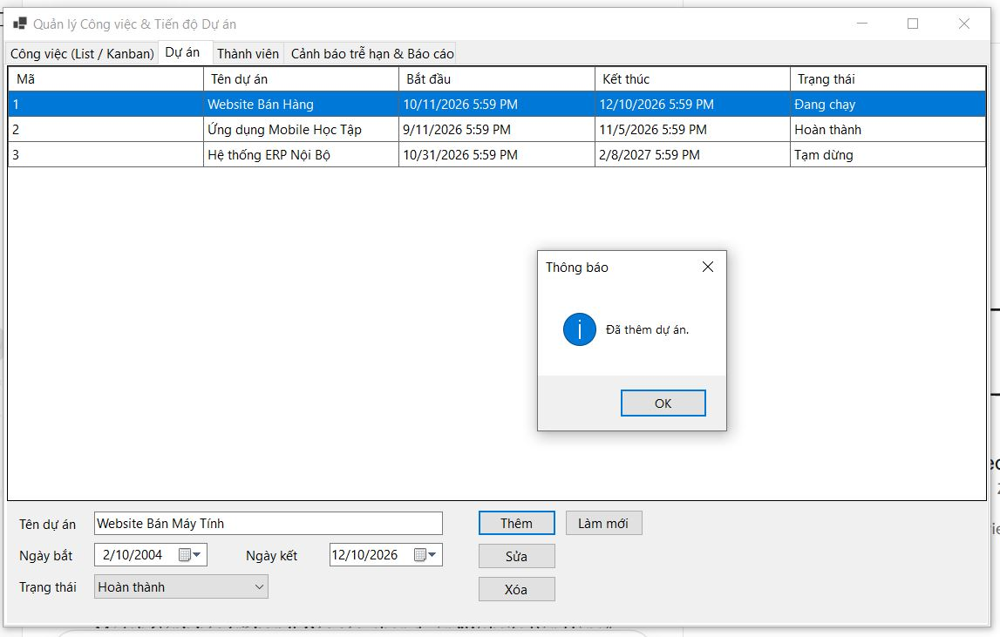
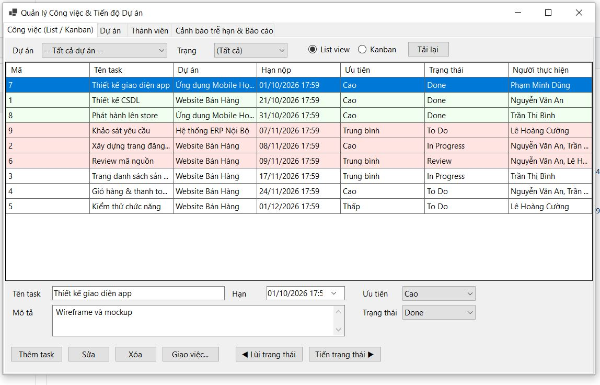
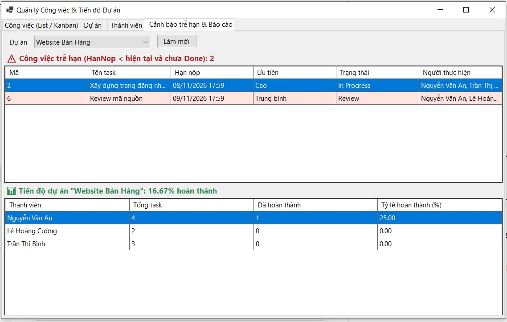
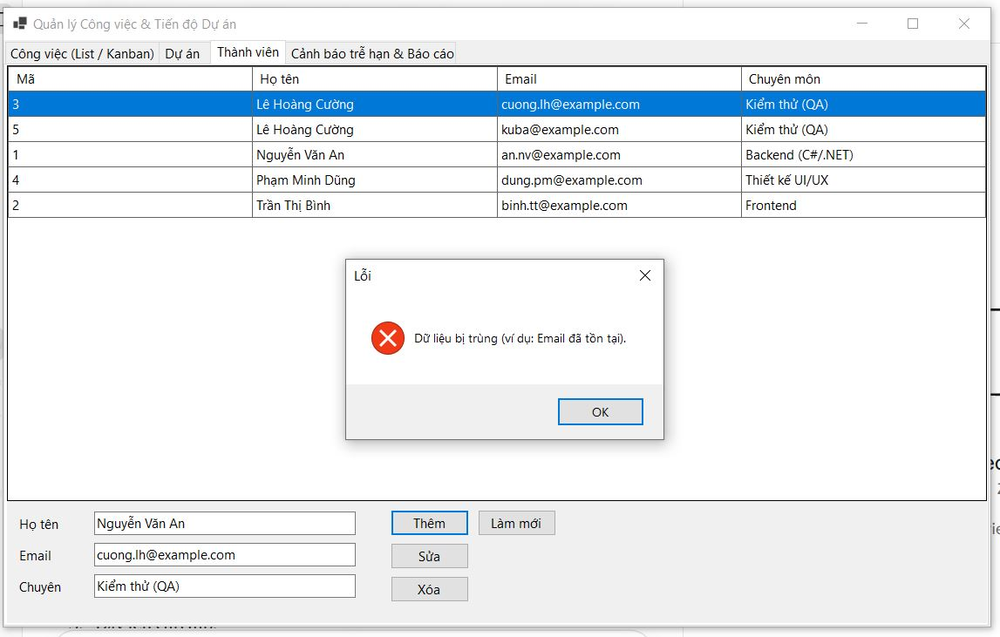

MỤC 1: THÔNG TIN SINH VIÊN
### Họ và tên sinh viên: Nguyễn Đức Anh
### Mã sinh viên: 24810320288
### Lớp / Khóa: D19QTANM1

MỤC 2: HÌNH ẢNH KẾT QUẢ CÁC MÀN HÌNH CHỨC NĂNG
1. Màn hình Chính / Tổng quan hệ thống:

2. Màn hình Quản lý Danh mục (CRUD - Thêm/Sửa/Xóa):

3. Màn hình Thực thi Nghiệp vụ chính (Lập Hóa đơn / Bán hàng / Chấm công / Đặt phòng):

4. Màn hình Báo cáo - Thống kê:

5. Minh họa An toàn Dữ liệu (Phòng chống SQL Injection / Báo lỗi Transaction Rollback):

